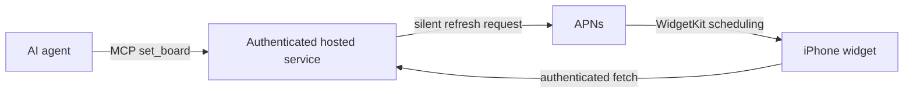

# Widget Board

A small native iPhone canvas that your AI agent can update through MCP.

Ask for a number to watch, a reminder, or a useful comparison. The agent writes a
validated JSON layout; WidgetKit renders it with native SwiftUI. One account has
one canvas, shared by the website and connected iPhones.


## What is here

- **`ios/`** — iPhone app, WidgetKit extension, encrypted device pairing, shared
  Keychain storage, and native rendering tests.
- **`sites/widget-board/`** — hosted website and MCP server, ChatGPT sign-in,
  per-user D1 storage, device management, and APNs refresh requests.
- **`server/`** — original localhost MCP prototype and the shared component catalog.
- **`scripts/`** — keeps the hosted catalog synchronized with the shared source.



This is an early prototype. The code is public; deployed canvases and credentials
are private. The reference deployment named in the source is owner-only, not a
public demo. Run your own deployment and change the endpoint before connecting.

## Local website development

Requires Node.js 22.13 or later.

```sh
cd sites/widget-board
npm run setup
npm run install:ci
npm run build
```

`setup` creates an ignored `.openai/hosting.json` from the example, without an
existing Site ID. It never replaces a local hosting configuration. Apply all
local database migrations after the first build:

```sh
for migration in drizzle/*.sql; do
  node --import ./scripts/sites-env.mjs ./node_modules/wrangler/bin/wrangler.js \
    d1 execute DB --local --config dist/server/wrangler.json \
    --persist-to .wrangler/state --file "$migration"
done
npm run dev -- --host 127.0.0.1 --port 4750
```

The local preview uses a simulated account and local D1 data. It does not test
hosted ChatGPT authentication. See [the hosted service guide](sites/widget-board/README.md)
for publication, authentication boundaries, device pairing, and runtime secrets.

The hosted implementation depends on Sites dispatch for authentication. Do not
expose this Worker directly on an untrusted public endpoint: its authenticated
identity headers must come from that trusted gateway. A different host needs an
appropriate authentication layer.

## Run on an iPhone

Requires macOS, Xcode, [XcodeGen](https://github.com/yonaskolb/XcodeGen), and an Apple
developer team with the required capabilities. The app targets iOS 17 or later;
WidgetKit push refresh is used on iOS 26 or later.

1. Deploy your own hosted service. Set its origin consistently in
   `ios/Shared/HostedConnection.swift` and
   `sites/widget-board/lib/device-pairing.ts` before publication and building.
2. Choose your own app bundle, App Group, and Keychain identifiers. Update
   `ios/project.yml` and `HostedConnection.swift` consistently. If you change the
   app bundle ID, also update the APNs topic in
   `sites/widget-board/lib/widget-push.ts`.
3. Generate and open the Xcode project:

   ```sh
   cd ios
   xcodegen generate
   open WidgetBoard.xcodeproj
   ```

4. Choose your signing team for both app and widget targets. Build and run on your
   iPhone, choose **Continue with ChatGPT**, and approve the device connection.
5. Add the **Board** Home Screen widget.

See [the iOS guide](ios/README.md) for capabilities, pairing, refresh behavior, and
tests. The cryptographic test fixture is synthetic and contains no live credentials;
regenerate it after changing the pinned service origin:

```sh
node --experimental-strip-types scripts/generate-pairing-fixture.mjs
```

Push acceptance is not proof that a widget has refreshed. iOS controls delivery
and timeline scheduling. The widget also requests a refresh every 15 minutes.

## Layout contract

Specs use [json-render](https://github.com/vercel-labs/json-render)'s flat tree
format. Components are validated before storage and rendered natively.

```json
{
  "root": "board",
  "elements": {
    "board": {
      "type": "Board",
      "props": { "title": null },
      "children": ["amount"]
    },
    "amount": {
      "type": "Stat",
      "props": {
        "label": "This Week",
        "value": "$312.50",
        "supportingText": "Down 18% from last month",
        "caption": null,
        "tone": "accent"
      },
      "children": []
    }
  }
}
```

The numbers above and the published render samples are synthetic.

| Component | Purpose |
| --- | --- |
| `Board` | Root container; optional title appears in details. |
| `Row` | Groups two or three related items. |
| `Stat` | Label, prominent formatted value, optional visible `supportingText`, and detail-only `caption`. |
| `Progress` | Label and progress fraction from 0 to 1. |
| `Note` | A short reminder or thought. |

A small widget shows the first content leaf. A medium widget can add the next two.
A Stat's supporting text stays with its value in both sizes. Every item is available
in the app and website detail view. Put one useful answer first and omit unnecessary
text; see [the design notes](docs/widget-design.md).

Components are defined in `server/src/catalog.ts`; validation and agent guidance
live in `server/src/spec.ts`. After editing either:

```sh
node scripts/sync-sites-catalog.mjs
```

The hosted copy builds independently. New native component types still require an
app update; this prototype does not execute downloaded layout code.

## Checks

```sh
npm --prefix server ci
npm --prefix server run typecheck
npm --prefix sites/widget-board test
npm --prefix sites/widget-board run typecheck
npm --prefix sites/widget-board run build
```

Run `WidgetBoardTests` from the **WidgetBoard** Xcode scheme on an available iOS
simulator. Tests cover pairing, credential isolation, cache behavior, content
projection, backward compatibility, and native render fixtures.

## Original localhost MCP prototype

```sh
cd server
npm ci
npm start
```

This serves MCP at `http://127.0.0.1:4747/mcp` and a simple `/boards/:id` API. It is
an unauthenticated local development server, not the backend used by the hosted
app. Keep it bound to localhost.

## License

MIT. See [LICENSE](LICENSE) and [third-party notices](THIRD_PARTY_NOTICES.md).
